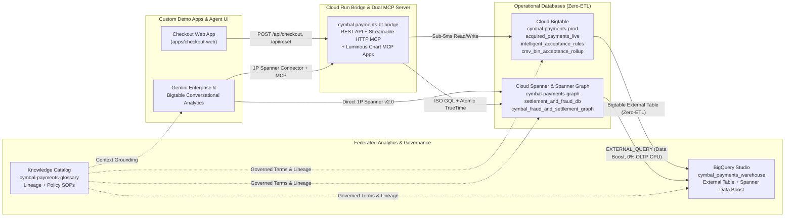

# Cymbal Payments — Cloud Bigtable & Spanner Graph Agentic Data Cloud Demo

> **From Passive System of Insights to Proactive System of Action.**
> End-to-end runnable codebase, deterministic datasets, custom live checkout app, Cloud Run Dual MCP Server, Knowledge Catalog governance, and CE / FDE playbooks for **Google Cloud Bigtable** and **Google Cloud Spanner Graph**.

---

## 1. What Is in This Repository?

This repository packages two connected enterprise fintech demonstrations for **Cymbal Payments** (a global payment processor running high-throughput card acquiring and 24/7 instant `T+0` merchant settlement on Google Cloud):

| Demo | Core Products | Business Problem | Live "Shock & Awe" Payoff |
| :--- | :--- | :--- | :--- |
| **[Demo 1: Intelligent Acceptance (Bigtable)](docs/DEMO_1_BIGTABLE_PLAYBOOK.md)** | **Cloud Bigtable**, **Bigtable Conversational Analytics**, **BigQuery External Tables**, **Knowledge Catalog**, **Cloud Run**, **Gemini Enterprise** | Legitimate UK cardholders (`Albion Bank UK`, `BIN 4532`) suffer a spike of **Soft Decline Code 05** on raw 16-digit cards (`77.8%` approval vs. `94.2%` 90-day baseline), putting **£421,200/day** in merchant GMV at risk. | Live checkout app writes a real `DECLINED` row to Bigtable -> diagnose in plain English via Bigtable CA + BigQuery Federation -> flip `cymbal_retail_uk#4532` to `NETWORK_TOKEN` (`96.7%`, `+1,890 bps`) -> re-run live checkout and watch it approve in milliseconds. |
| **[Demo 2: Zero-ETL Fraud Rings & T+0 Settlement (Spanner Graph)](docs/DEMO_2_SPANNER_GRAPH_PLAYBOOK.md)** | **Cloud Spanner**, **Spanner Graph (ISO GQL)**, **Spanner Data Boost**, **BigQuery Federation**, **Knowledge Catalog**, **1P Spanner Connector in Gemini Enterprise** | Three European sub-merchants (**Apex Digital UK**, **Nova Goods FR**, **Veloce Trade DE**) pass row-level ML fraud checks (`0.12` score) while requesting **€480,000** in instant `T+0` payouts. | Zero-ETL 3-hop ISO GQL query uncovers **24 cycled Cyprus prepaid cards**, **6 headless proxy devices**, and **1 shared Dubai UBO IBAN** (`€375K` prior syndicate loss in BigQuery via Data Boost, `99.4%` LLM token reduction) -> execute an **atomic TrueTime transaction** freezing all €480,000 simultaneously. |

---

## 2. End-to-End Architecture



For a technical deep-dive into Data Boost isolation, 99.4% graph-rollup tokenomics, and TrueTime external consistency, see **[docs/ARCHITECTURE.md](docs/ARCHITECTURE.md)**.

---

## 3. Repository Structure

```text
cymbal-payments-demo/
├── README.md                                  # You are here
├── .env.example                               # Copy to .env and set your PROJECT_ID
├── config.py                                  # Shared .env loader & gcloud REST helpers
├── requirements.txt                           # Minimal dependencies (requests)
│
├── data/
│   ├── spanner/schema.sql                     # 7 relational tables + Property Graph DDL
│   ├── sql/
│   │   ├── bigtable_btql_queries.sql          # Ready-to-run Bigtable Studio BTQL queries
│   │   ├── spanner_gql_queries.sql            # Ready-to-run Spanner Graph ISO GQL + reset DML
│   │   └── bigquery_federated_queries.sql     # BigQuery Studio queries (Bigtable & Spanner Data Boost)
│   └── governance/
│       ├── ALBION-BANK-4532-ISSUER-ADVISORY-AND-ROUTING-SOP.md
│       └── intelligent_acceptance_token_routing_pipeline.py
│
├── scripts/                                   # Run 01 -> 05 in order; idempotent
│   ├── 01_setup_bigtable.py                   # Provisions Bigtable, 460 synthetic rows, Logical View & CMV
│   ├── 02_setup_spanner_graph.py              # Provisions Spanner (100 PU) + Property Graph + €480K ring
│   ├── 03_setup_bigquery_federation.py        # Creates Bigtable External Table + Spanner Data Boost Views
│   ├── 04_setup_knowledge_catalog.py          # Creates Glossary, 5 Terms, Entry Links & GCS Policy Bucket
│   ├── 05_setup_agents_and_connectors.py      # Creates CA Data Agents (+ optional Gemini Enterprise connectors)
│   └── reset_demo.py                          # One-command pre-demo reset for Bigtable & Spanner
│
├── apps/
│   ├── checkout-web/                          # Custom Cymbal Payments Wallet & Express Checkout App
│   │   ├── index.html                         # Self-contained UI with live Bigtable animations & hidden reset
│   │   ├── config.example.js                  # Set your deployed Cloud Run URL here
│   │   ├── serve_local.py                     # Local dev server (python3 apps/checkout-web/serve_local.py)
│   │   └── README.md
│   └── cloud-run-bridge-mcp/                  # Unified Cloud Run Backend + Dual MCP Server
│       ├── main.py                            # Checkout API + Bigtable & Spanner Luminous MCP Apps
│       ├── Dockerfile
│       ├── deploy.sh                          # One-command Cloud Run deployment + IAM setup
│       └── README.md
│
└── docs/
    ├── ARCHITECTURE.md                        # Deep-dive on Data Boost, tokenomics & TrueTime
    ├── DEMO_1_BIGTABLE_PLAYBOOK.md            # CE / FDE setup & Say/Do/See script for Demo 1
    └── DEMO_2_SPANNER_GRAPH_PLAYBOOK.md       # CE / FDE setup & Say/Do/See script for Demo 2
```

---

## 4. Quickstart: Deploy Into Your Own Google Cloud Project (~10 Minutes)

### Prerequisites
- A Google Cloud project with billing enabled and Owner/Editor IAM permissions
- [Google Cloud CLI (`gcloud`)](https://cloud.google.com/sdk/docs/install) authenticated (`gcloud auth login`)
- Python 3.10+

### Step 1: Clone & Configure `.env`
```bash
git clone https://github.com/szinsmeister-google/cymbal-payments-demo.git
cd cymbal-payments-demo

cp .env.example .env
# Edit .env and set PROJECT_ID=<your-gcp-project-id>
```

### Step 2: Enable Required Google Cloud APIs
```bash
source .env
gcloud services enable \
  bigtable.googleapis.com \
  bigtableadmin.googleapis.com \
  spanner.googleapis.com \
  bigquery.googleapis.com \
  bigqueryconnection.googleapis.com \
  dataplex.googleapis.com \
  geminidataanalytics.googleapis.com \
  run.googleapis.com \
  cloudbuild.googleapis.com \
  storage.googleapis.com \
  --project="${PROJECT_ID}"
```

### Step 3: Provision Data, Views, Governance & Data Agents
```bash
python3 scripts/01_setup_bigtable.py
python3 scripts/02_setup_spanner_graph.py
python3 scripts/03_setup_bigquery_federation.py
python3 scripts/04_setup_knowledge_catalog.py
python3 scripts/05_setup_agents_and_connectors.py
```

### Step 4: Deploy the Cloud Run Backend & Dual MCP Server
```bash
chmod +x apps/cloud-run-bridge-mcp/deploy.sh
./apps/cloud-run-bridge-mcp/deploy.sh
```
Copy the printed `Base URL` (e.g. `https://cymbal-payments-bt-bridge-xxxxx-uc.a.run.app`).

*(Optional)* If you are wiring **Gemini Enterprise**, set `MCP_BASE_URL` in `.env` to your deployed Cloud Run URL and run:
```bash
python3 scripts/05_setup_agents_and_connectors.py --with-gemini-enterprise
```

### Step 5: Launch the Custom Cymbal Payments Checkout App
```bash
cp apps/checkout-web/config.example.js apps/checkout-web/config.js
# Paste your Cloud Run Base URL into apps/checkout-web/config.js

python3 apps/checkout-web/serve_local.py
# Open http://localhost:8090 in Chrome
```

---

## 5. Resetting Between Customer Demos

Run the unified reset script at any time to restore **Bigtable** (`cymbal_retail_uk#4532` -> `RAW_PAN` and delete live `#tx_live_` checkout writes) and **Spanner** (all 3 ring sub-merchants -> `PENDING_GRAPH_GATE`):

```bash
python3 scripts/reset_demo.py                 # Reset both demos
python3 scripts/reset_demo.py --bigtable-only # Reset Demo 1 only
python3 scripts/reset_demo.py --spanner-only  # Reset Demo 2 only
```

> **Live Stage Tip (Checkout App):** During a live Demo 1 presentation, you can also reset or toggle the Bigtable routing rule directly from the browser by clicking the **Alex Mercer (`AM`)** profile pill in the top-right corner of the Checkout App.

---

## 6. Fictitious Demo Entities

All merchants, issuing banks, card tokens, and account numbers in this repository are 100% synthetic and fictitious:
- **Demo 1 Issuing Banks:** `Albion Bank UK` (`BIN 4532`), `Thames Commercial Bank` (`BIN 5412`), `Crown & Sterling Bank` (`BIN 4929`), `Banque Lumiere FR` (`BIN 4024`), `Rheinland Bank DE` (`BIN 5200`).
- **Demo 2 Sub-Merchants & UBO:** `Apex Digital Ltd (UK)`, `Nova Goods SARL (FR)`, `Veloce Trade GmbH (DE)`, `Zentra Holdings FZE` (`AE47033120000099887766`), plus clean enterprise merchants (`Cymbal Retail UK`, `Lumiere Luxe Paris`, `Nordic Outdoor AB`, `Iberian Travel Group`).
